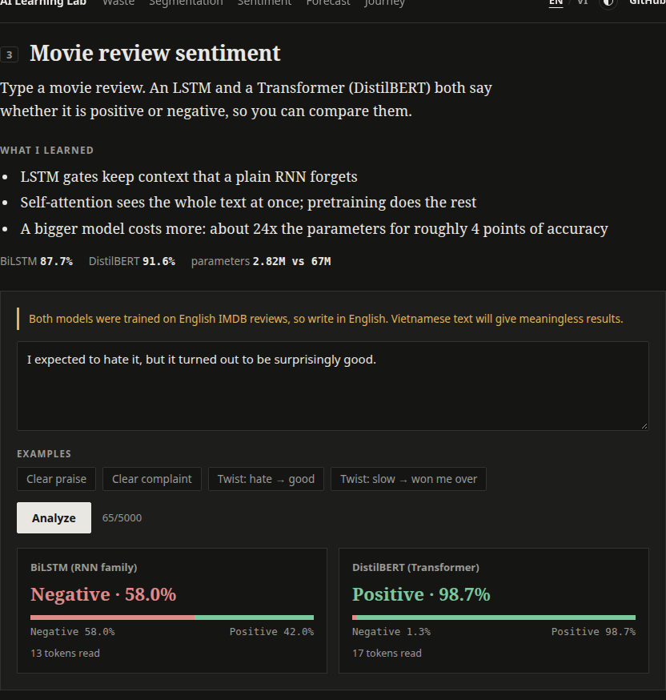

# AI Learning Lab

[English](README.md) | [Tiếng Việt](README_vi.md)

[](https://github.com/tranvanhuy-hichan/ai-learning-lab/actions/workflows/ci.yml)


A personal repository where I **apply what I learn about AI**. I study from courses and books, write a short note, then build and measure a model here. It is a learning project: nothing in it is production-ready, and it is not set up to take contributions.

> **Learn → Note → Apply**
> [Roadmap](learning/ROADMAP.md) · [Learning log](learning/log) · [Notes](learning/notes) · [Projects](projects)



## Try it

```bash
git clone https://github.com/tranvanhuy-hichan/ai-learning-lab.git
cd ai-learning-lab/projects/lab-web
python -m venv .venv && source .venv/bin/activate
pip install -r requirements.txt
python -m labweb          # open http://127.0.0.1:8000
```

A bilingual (English / Vietnamese) web app with light and dark themes. It runs on a CPU. Details: [`projects/lab-web`](projects/lab-web).

## Projects

| Project | What it covers | Headline result |
|---|---|---|
| [`vision-toolkit`](projects/vision-toolkit) | Waste classification (CNN, ResNet18, EfficientNet-B0) and pet segmentation (U-Net, ResNet18-encoder U-Net), with a Gradio app | EfficientNet-B0 96.1% accuracy; segmentation mIoU 0.767 and 0.809 |
| [`sequence-modeling`](projects/sequence-modeling) | RNN, LSTM and Transformer on temperature forecasting and IMDB sentiment | DistilBERT 91.6% vs BiLSTM 87.7%; RNN and LSTM beat "same as today" by about 15% |
| [`lab-web`](projects/lab-web) | One web interface for all the models above | 4 tools, English and Vietnamese |

## What I am learning

The [roadmap](learning/ROADMAP.md) tracks a 24-week plan and says honestly what is only *applied* here and what I have not tracked yet. The short notes cover [CNNs](learning/notes/01-cnn-and-channels.md), [transfer learning](learning/notes/02-transfer-learning.md), [classification metrics](learning/notes/03-classification-metrics.md), [U-Net](learning/notes/04-unet-segmentation.md), [RNN and LSTM](learning/notes/05-rnn-lstm.md), the [Transformer](learning/notes/06-transformer-attention.md), and [how to run honest experiments](learning/notes/07-honest-experiments.md), including a hypothesis of mine that the data disproved.

## How honest are the numbers?

- Every result comes from a single training run with one seed. Small gaps are noise until repeated.
- Some comparisons change several things at once (for example the two segmentation models), so I do not claim which change helped.
- Limits are written next to each result: the waste classifier has not been tested on messy real-world photos; the sentiment models understand English only.

## Repository layout

```
learning/        roadmap, dated log, bilingual notes
projects/
  vision-toolkit/      classification + segmentation, Gradio app, training notebooks, weights
  sequence-modeling/   RNN / LSTM / Transformer notebooks and results
  lab-web/             FastAPI + vanilla JS bilingual web app
docs/images/     screenshots used in the READMEs
```

`make web` runs the web app, `make test` runs every project's tests, and `make lint` runs ruff. CI runs the same checks.

## Transparency

I use an AI coding assistant (Claude Code) to help write code and explanations from my questions. I train and read the results myself, and the notes record where my first guess was wrong.

## License

MIT, see [LICENSE](LICENSE). The datasets keep their own licenses and are not included: Oxford-IIIT Pet (CC BY-SA 4.0), a 12-class garbage dataset from the Hugging Face hub (check its license before reuse), Melbourne daily temperatures and IMDB reviews. Pretrained backbones come from torchvision and Hugging Face.
