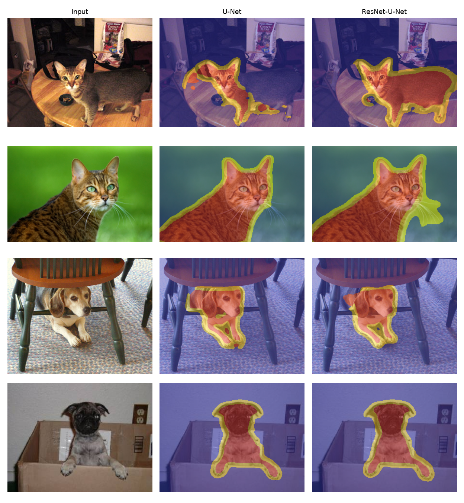

# AI Vision Toolkit

[English](README.md) | [Tiếng Việt](README_vi.md)

[](https://github.com/tranvanhuy-hichan/ai-vision-toolkit/actions/workflows/ci.yml)
[](LICENSE)


Ứng dụng web thị giác máy tính nhỏ, gộp hai mô hình học sâu được huấn luyện bằng PyTorch:

| Tab | Bài toán | Mô hình | Dữ liệu |
|---|---|---|---|
| **Phân loại rác** | Ảnh chứa loại rác nào trong 12 loại, kèm gợi ý xử lý/tái chế | EfficientNet-B0 (pretrained ImageNet, fine-tune) | 15.515 ảnh, 12 lớp |
| **Phân đoạn thú cưng** | Gán nhãn từng pixel của ảnh chó/mèo: con vật / nền / viền | U-Net tự viết từ đầu; tùy chọn U-Net dùng encoder ResNet18 | Oxford-IIIT Pet |



*Trái: ảnh gốc. Giữa: U-Net tự viết. Phải: U-Net encoder ResNet18 (đỏ = con vật, xanh = nền, vàng = viền). Ở ảnh đầu tiên, U-Net tự viết bỏ sót phần lớn thân tối của con mèo còn bản ResNet nhận ra được; ở ảnh thứ hai, bản ResNet thêm một vùng viền thừa bên phải.*

## Chạy nhanh

```bash
git clone <repo-này> && cd ai-vision-toolkit
python -m venv .venv && source .venv/bin/activate
pip install -r requirements.txt
python app.py            # mở http://127.0.0.1:7860
```

Trọng số đã train của cả ba mô hình có sẵn trong `models/` (tổng khoảng 105 MB, file lớn nhất 57 MB). Không bắt buộc có GPU.

## Phát triển

```bash
pip install -r requirements.txt -r requirements-dev.txt
make test    # pytest
make lint    # ruff check + kiểm tra định dạng
```

Xem [CONTRIBUTING.md](CONTRIBUTING.md), [model card](models/MODEL_CARD.md) và [changelog](CHANGELOG.md).

## Kết quả (trên tập test giữ riêng)

| Mô hình | Chỉ số | Kết quả |
|---|---|---|
| EfficientNet-B0, rác (12 lớp, 128 px, 10 epoch) | Accuracy / macro F1 | **96,1%** / 0,953 |
| U-Net tự viết, thú cưng (128 px, 30 epoch) | mIoU (pixel accuracy) | **0,767** (91,3%) |
| U-Net encoder ResNet18, thú cưng (256 px, 25 epoch) | mIoU (pixel accuracy) | **0,809** (93,1%) |

Cách đọc các con số:

- **Rác:** ứng dụng tái tạo đúng accuracy của notebook huấn luyện trên cùng tập test 2.328 ảnh (96,13%). Các notebook cũng huấn luyện CNN thuần và ResNet18 để so sánh (`training/classification/04_compare.ipynb`).
- **Phân đoạn:** mIoU của U-Net tự viết đo trên 3.669 ảnh test chính thức được resize về 128 px. Nếu so với mask độ phân giải gốc trên 400 ảnh test ngẫu nhiên, U-Net tự viết đạt 0,733 và U-Net encoder ResNet18 đạt 0,772 (cùng ảnh, cùng cách chấm), vì viền mỏng khó khớp ở độ phân giải đầy đủ. Khoảng cách giữa hai mô hình tương tự ở cả hai cách đo.
- **Lớp `border` (viền) yếu nhất** (IoU 0,548 với U-Net tự viết, 0,617 với bản encoder ResNet18) vì chỉ rộng vài pixel.
- Mô hình encoder ResNet18 khác U-Net tự viết ở nhiều điểm cùng lúc (encoder pretrained, ảnh 256 px, trọng số lớp viền, số epoch) nên không quy mức cải thiện cho riêng một thay đổi nào.
- Mọi kết quả là một lần huấn luyện với một seed.

### Chọn mô hình phân đoạn

Ứng dụng liệt kê mọi mô hình phân đoạn có trọng số trong `models/`; chọn trong danh sách thả xuống. Trọng số encoder ResNet18 (`resnet_unet_pet.pt`, 57 MB) được huấn luyện bằng `training/segmentation/02_resnet_unet_colab_kaggle.ipynb` (khoảng 11 phút trên Kaggle T4). GitHub cảnh báo với file trên 50 MB; nếu muốn, hãy đưa file này vào mục Release thay vì commit.

## Hạn chế

- **Bộ phân loại rác:** ảnh huấn luyện chủ yếu là một món đồ trên nền đơn giản. Với ảnh thực tế lộn xộn, độ chính xác sẽ thấp hơn 96% (chưa được đo). Mô hình luôn chọn một trong 12 lớp, kể cả khi vật thể nằm ngoài các lớp đó.
- **Phân đoạn:** chỉ huấn luyện trên chó và mèo của Oxford-IIIT Pet; không dành cho động vật hay vật thể khác.
- Gợi ý tái chế chỉ mang tính tham khảo chung; quy định khác nhau theo từng địa phương.

## Cấu trúc dự án

```
app.py                      Ứng dụng Gradio (hai tab)
src/vision_toolkit/
    models.py               Đầu EfficientNet, U-Net, ResNet-U-Net
    inference.py            tiền xử lý, dự đoán, vẽ chồng lớp
models/                     trọng số đã train + nhãn lớp
examples/                   ảnh thú cưng mẫu
tests/                      kiểm thử đơn vị (pytest)
scripts/make_demo_figure.py tạo lại assets/segmentation_demo.png
training/
    classification/         notebook: CNN, ResNet18, EfficientNet-B0
    segmentation/           notebook: U-Net và U-Net encoder ResNet18
```

Các notebook huấn luyện cần bộ dữ liệu trong thư mục `data/` cạnh mỗi `common.py` (không kèm theo, xem bên dưới).

## Dữ liệu và ghi nhận

- **Oxford-IIIT Pet** (Parkhi và cộng sự, 2012), giấy phép CC BY-SA 4.0. Bốn ảnh mẫu trong `examples/` lấy từ bộ này.
- **Garbage Classification, 12 lớp**: lấy từ bộ dữ liệu Hugging Face `UdaraChamidu/Garbage-Classification-with-12-classes`. Ảnh không được phân phối lại ở đây; hãy kiểm tra giấy phép gốc trước khi dùng lại.
- Backbone pretrained (EfficientNet-B0, ResNet18) lấy từ torchvision (trọng số ImageNet).

## Giấy phép

Mã nguồn: MIT, xem [LICENSE](LICENSE). Các bộ dữ liệu giữ giấy phép riêng.
