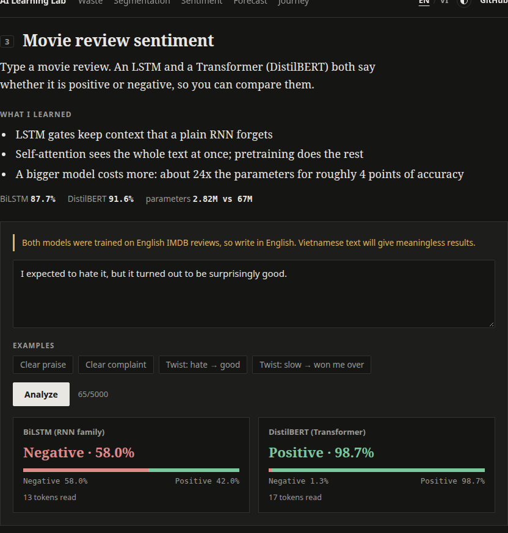
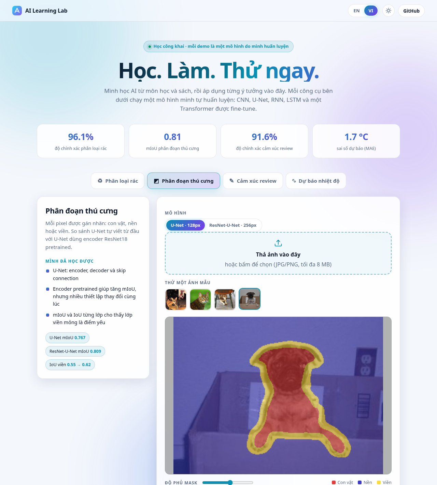

# Lab Web

[English](README.md) | [Tiếng Việt](README_vi.md)

> Part of [AI Learning Lab](../../README.md). One bilingual (English / Vietnamese) web interface for every model I train in this repository. It is a learning project, not a product.




| Tool | Model | What you can do |
|---|---|---|
| Waste classifier | EfficientNet-B0 | Drop a photo, get the top 5 classes and a recycling tip |
| Pet segmentation | U-Net, ResNet18-encoder U-Net | Segment a cat or dog photo, switch models, change mask opacity |
| Review sentiment | BiLSTM, DistilBERT | Type an English review and compare an LSTM with a Transformer |
| Temperature forecast | RNN, LSTM | Pick a 30-day window and compare forecasts with baselines and the real value |

Each tool also shows "what I learned" and the real test metrics of its model. The page switches between **English and Vietnamese** (it follows your browser at first) and between **light and dark** themes.

## Run it

```bash
git clone https://github.com/tranvanhuy-hichan/ai-learning-lab.git
cd ai-learning-lab/projects/lab-web
python -m venv .venv && source .venv/bin/activate
pip install -r requirements.txt     # run from this folder: it installs ../vision-toolkit in editable mode
python -m labweb                    # open http://127.0.0.1:8000
```

No GPU is needed; every model here is small enough for a CPU. The front-end is plain HTML, CSS and JavaScript (no build step, no external libraries or fonts).

### Optional: the DistilBERT comparison

The fine-tuned DistilBERT checkpoint is 268 MB, so it is not committed. Without it the sentiment tool shows only the LSTM. To enable it, run notebook 03 of [`sequence-modeling`](../sequence-modeling) (about 10 minutes on a 4 GB GPU) and copy `outputs/distilbert_imdb.pt` to `models/distilbert_imdb.pt` (or set `LABWEB_DISTILBERT_WEIGHTS=/path/to/file`). Install `transformers` too. The tokenizer config is downloaded from the Hugging Face hub on first use.

## API

The interactive docs are at `/api/docs` while the server runs.

| Method and path | Purpose |
|---|---|
| `GET /api/models` | Which models are installed, plus their metrics |
| `POST /api/waste` | multipart `file` (image, up to 8 MB) |
| `POST /api/segment` | multipart `file`, optional `model`; returns a PNG mask and pixel shares |
| `POST /api/sentiment` | JSON `{"text": "...", "model": "lstm" or "distilbert"}` |
| `GET /api/forecast/samples`, `POST /api/forecast` | JSON `{"values": [30 temperatures in °C]}` |

## How it works

`labweb/` is a small FastAPI app. Waste and segmentation call the inference code of [`vision-toolkit`](../vision-toolkit); the sequence models are defined in `labweb/seq_models.py`, matching the training code so the saved weights load unchanged. `static/` holds the front-end. `scripts/export_assets.py` rebuilds the small files in `models/` (vocabulary, normalisation statistics, sample windows, metrics) from the training project.

## Tests

```bash
pip install -r requirements-dev.txt
pytest          # 18 tests: every endpoint, input validation, and the served front-end
```

## Limits

- The sentiment models were trained on English IMDB reviews only.
- The waste classifier was trained on single items on plain backgrounds; accuracy on messy photos is unmeasured.
- The segmentation models know cats and dogs only.
- Metrics shown in the page come from single training runs.
- Uploaded images are processed in memory and not saved. If you expose the app beyond your own machine, add authentication and rate limits first; this project does not include them.
