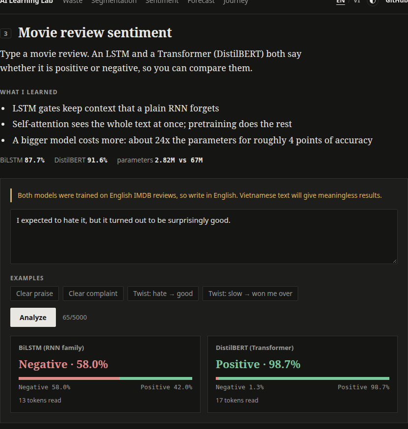
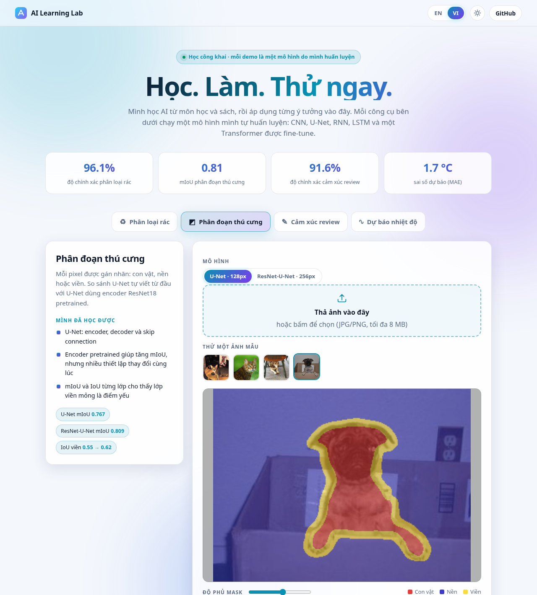

# Lab Web

[English](README.md) | [Tiếng Việt](README_vi.md)

> Một phần của [AI Learning Lab](../../README_vi.md). Một giao diện web song ngữ (Anh / Việt) cho mọi mô hình mình huấn luyện trong repo này. Đây là dự án học tập, không phải sản phẩm.




| Công cụ | Mô hình | Bạn làm được gì |
|---|---|---|
| Phân loại rác | EfficientNet-B0 | Thả ảnh, nhận 5 lớp cao nhất và gợi ý tái chế |
| Phân đoạn thú cưng | U-Net, U-Net encoder ResNet18 | Phân đoạn ảnh chó mèo, đổi mô hình, chỉnh độ phủ mask |
| Cảm xúc review | BiLSTM, DistilBERT | Gõ review tiếng Anh và so sánh LSTM với Transformer |
| Dự báo nhiệt độ | RNN, LSTM | Chọn cửa sổ 30 ngày, so dự báo với các mốc và giá trị thật |

Mỗi công cụ còn hiện "mình đã học được" và chỉ số test thật của mô hình. Trang chuyển được giữa **tiếng Anh và tiếng Việt** (ban đầu theo trình duyệt của bạn) và giữa giao diện **sáng và tối**.

## Chạy thử

```bash
git clone https://github.com/tranvanhuy-hichan/ai-learning-lab.git
cd ai-learning-lab/projects/lab-web
python -m venv .venv && source .venv/bin/activate
pip install -r requirements.txt     # chạy trong thư mục này: nó cài ../vision-toolkit ở chế độ editable
python -m labweb                    # mở http://127.0.0.1:8000
```

Không cần GPU; mọi mô hình ở đây đủ nhỏ để chạy trên CPU. Front-end là HTML, CSS và JavaScript thuần (không bước build, không thư viện hay font bên ngoài).

### Tùy chọn: so sánh với DistilBERT

Checkpoint DistilBERT đã fine-tune nặng 268 MB nên không được commit. Thiếu nó, công cụ cảm xúc chỉ hiển thị LSTM. Để bật, chạy notebook 03 trong [`sequence-modeling`](../sequence-modeling) (khoảng 10 phút trên GPU 4 GB) rồi chép `outputs/distilbert_imdb.pt` sang `models/distilbert_imdb.pt` (hoặc đặt `LABWEB_DISTILBERT_WEIGHTS=/đường/dẫn/file`). Cài thêm `transformers`. Cấu hình tokenizer được tải từ Hugging Face hub ở lần dùng đầu tiên.

## API

Tài liệu tương tác ở `/api/docs` khi server đang chạy.

| Phương thức và đường dẫn | Mục đích |
|---|---|
| `GET /api/models` | Mô hình nào đã cài, kèm chỉ số |
| `POST /api/waste` | multipart `file` (ảnh, tối đa 8 MB) |
| `POST /api/segment` | multipart `file`, `model` tùy chọn; trả về mask PNG và tỉ lệ pixel |
| `POST /api/sentiment` | JSON `{"text": "...", "model": "lstm" hoặc "distilbert"}` |
| `GET /api/forecast/samples`, `POST /api/forecast` | JSON `{"values": [30 nhiệt độ °C]}` |

## Cách hoạt động

`labweb/` là một app FastAPI nhỏ. Phân loại rác và phân đoạn gọi code suy luận của [`vision-toolkit`](../vision-toolkit); các mô hình chuỗi được định nghĩa trong `labweb/seq_models.py`, khớp với code huấn luyện nên trọng số đã lưu nạp vào được nguyên vẹn. `static/` chứa front-end. `scripts/export_assets.py` dựng lại các file nhỏ trong `models/` (từ vựng, thống kê chuẩn hóa, cửa sổ mẫu, chỉ số) từ dự án huấn luyện.

## Kiểm thử

```bash
pip install -r requirements-dev.txt
pytest          # 18 test: mọi endpoint, kiểm tra đầu vào và front-end được phục vụ
```

## Giới hạn

- Các mô hình cảm xúc chỉ được huấn luyện trên review IMDB tiếng Anh.
- Bộ phân loại rác học từ ảnh một món đồ trên nền đơn giản; độ chính xác trên ảnh lộn xộn chưa được đo.
- Các mô hình phân đoạn chỉ biết chó và mèo.
- Chỉ số hiển thị trên trang đến từ các lần huấn luyện đơn lẻ.
- Ảnh tải lên được xử lý trong bộ nhớ và không lưu lại. Nếu mở app ra ngoài máy của bạn, hãy thêm xác thực và giới hạn tần suất trước; dự án này không có sẵn.
